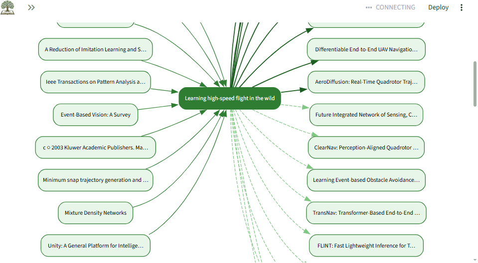
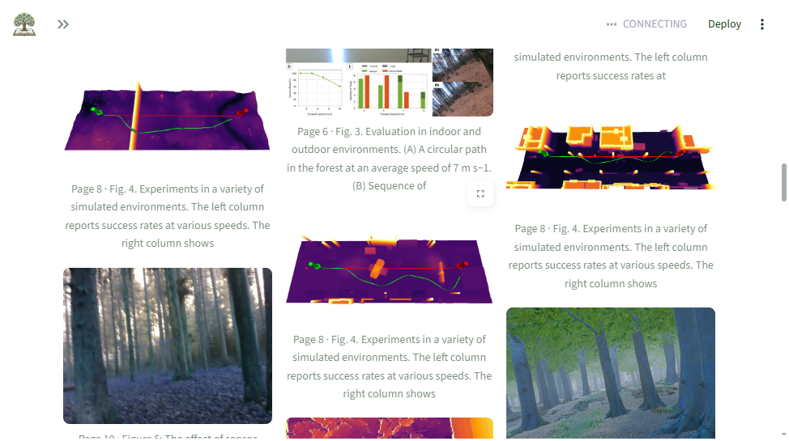
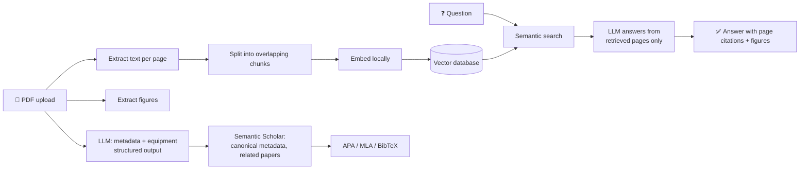

<p align="center">
  
</p>

<h1 align="center">TreeRoute</h1>

<p align="center">
  <b>An AI research assistant for scientific papers.</b><br>
  Upload a PDF. Ask questions and get answers that cite the exact page, plus ready-made citations,
  a map of related papers, the hardware the authors used, and the paper's figures.
</p>

<p align="center">
  <a href="#demo">Demo</a> ·
  <a href="#features">Features</a> ·
  <a href="#how-it-works">How it works</a> ·
  <a href="#tech-stack">Tech stack</a> ·
  <a href="#contact">Contact</a>
</p>

> **Source code is private.** This repository shows what TreeRoute does and how it is built,
> with a few code samples. A live walkthrough or code review is available on request: see [Contact](#contact).

---

## Demo

<!-- Replace with your video link, e.g. a YouTube or Loom URL, and the live app link when deployed. -->
🎥 **Video walkthrough:** _coming soon_
🌐 **Live app:** _coming soon_

| Related-papers tree | Figures from the paper |
|---|---|
|  |  |

<!-- When you add screenshots/chat.png and screenshots/equipment.png, uncomment this table:
| Chat with page citations | Equipment finder |
|---|---|
|  |  |
-->

## Features

| | Feature | What it does |
|---|---|---|
| 💬 | **Chat with citations** | Answers questions using only the uploaded papers and cites every claim with the page number, e.g. `[1] attention.pdf, page 3`. If the answer is not in the papers, it says so instead of guessing. |
| 📚 | **Automatic citation** | Generates APA 7, MLA 9 and BibTeX for every paper, with authors, venue and DOI/arXiv id checked against Semantic Scholar. One-click `.bib` download. |
| 🌳 | **Related-papers tree** | An interactive graph of what the paper builds on, what cites it, and papers on the same topic, each linked. |
| 🔧 | **Equipment finder** | Finds the PCs, GPUs, drones/UAVs, robots, cameras, sensors, embedded boards, software and datasets the authors used. Each gets a card with what it is, how the paper used it, quantity, specs, and store buttons (Amazon, Newegg, eBay, AliExpress, Google Shopping). |
| 🖼️ | **Figures** | Extracts the paper's real figures, including vector charts, and shows the relevant ones next to answers that cite their page. |

**Built to be reliable:** an upload never fails because an outside service is down. If the AI model or
the paper database is unavailable, the paper is still indexed for chat and the app shows a clear warning.

## How it works



1. **Retrieval-augmented generation (RAG):** each page is split into overlapping chunks that never cross page boundaries, so every citation points to a real page.
2. **Local embeddings:** chunks are embedded on the machine, so indexing a paper costs nothing.
3. **Grounded answers:** the LLM only sees the retrieved chunks and must cite them by number.
4. **Structured extraction:** the LLM returns metadata and equipment as JSON validated against a schema.
5. **Enrichment:** Semantic Scholar supplies canonical author lists, DOIs and the citation graph, with retries and backoff for rate limits.

## Tech stack

| Layer | Tools |
|---|---|
| AI | Google Gemini (free tier) or Claude, switchable by config; structured outputs; RAG |
| Retrieval | ChromaDB vector database, local ONNX embeddings (BGE-small) |
| Backend | Python 3.11, FastAPI, Pydantic |
| Frontend | Streamlit with a custom theme |
| PDF processing | pypdf, pdfium |
| External data | Semantic Scholar API |
| Quality | pytest (65 tests), ruff, mypy, pre-commit |
| DevOps | Docker, GitHub Actions CI/CD, GitHub Container Registry |

## Code samples

Two small, self-contained modules from the project, with their tests:

- [`samples/chunking.py`](samples/chunking.py): page-aware text chunking with overlap that never splits a word.
- [`samples/citation.py`](samples/citation.py): APA, MLA and BibTeX formatting from paper metadata.

```bash
pip install -r requirements.txt
pytest
```

The tests run automatically on every push ([workflow](.github/workflows/ci.yml)).

## Contact

Built by **Faiza Mehram**. I build custom AI tools: RAG systems, document intelligence and LLM-powered apps.

Want TreeRoute for your lab or team, a custom feature, or something similar built for your documents?

- 📧 Email: mehramfaiza@gmail.com
- 💼 LinkedIn: [LinkedIn](https://www.linkedin.com/in/faiza-mehram-069ab3241/)
- 🌐 Portfolio: [GitHub(https://github.com/faiza-mehram437)

## License

Copyright © 2026 Faiza Mehram. All rights reserved. See [LICENSE](LICENSE).
